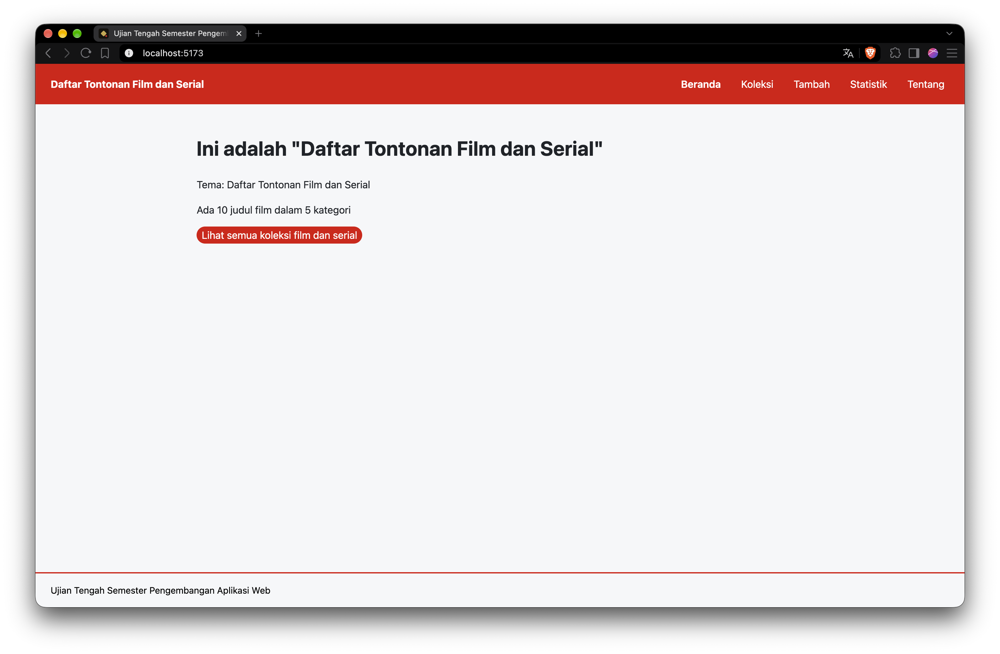
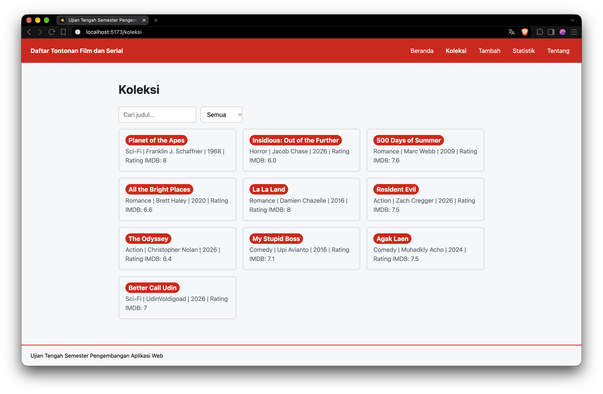
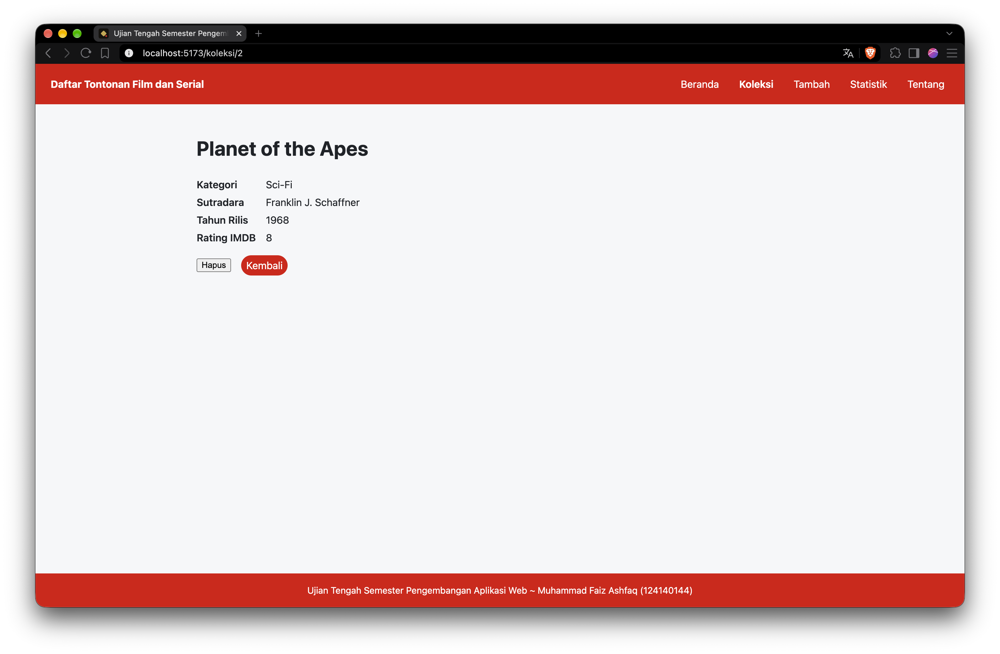
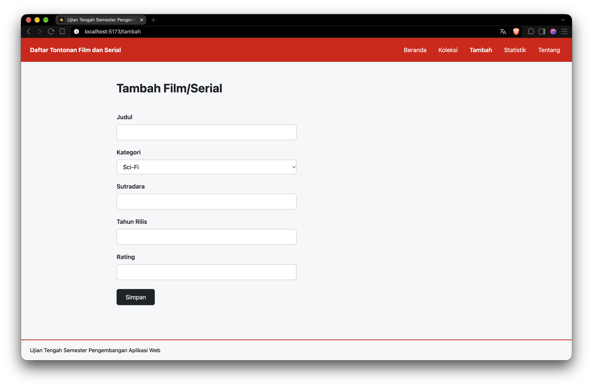
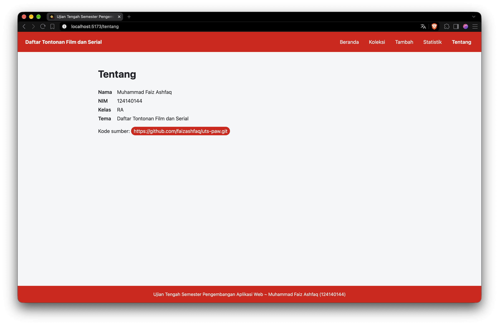
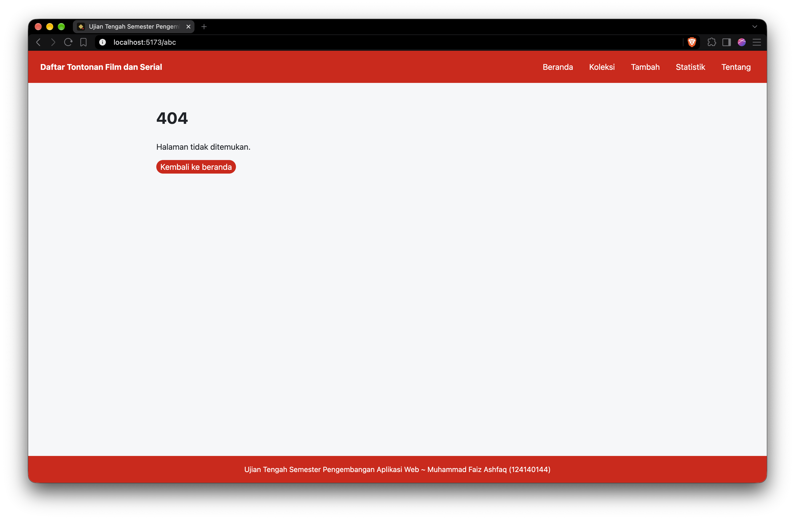

# Ujian Tengah Semester IF25-22014 Pengembangan Aplikasi Web

# Daftar Tontonan Film dan Serial

```markdown
Nama: Muhammad Faiz Ashfaq
NIM: 124140144
Kelas: RA
Tema: Daftar Tontonan Film dan Serial
Deployment: https://faizashfaq.github.io/uts-paw/
```
- **Halaman Beranda**


- **Halaman Koleksi**


- **Halaman Detail Koleksi**


- **Halaman Tambah**


- **Halaman Statistik**


- **Halaman Tentang**


- **Halaman 404 Tidak DItemukan**


## Fitur

- Menampilkan daftar tontonan film dan serial
- Pencarian berdasarkan judul dan filter kategori
- Halaman detail dari setiap judul film dan serial
- Menambah film dan serial baru ke koleksi (tersimpan di localStorage)
- Menghapus film dan serial yang ada dari halaman detail
- Menampilkan data statistik jumlah film dan serial berdasarkan kategori
- Menampilkan halaman tentang yang berisi identitas mahasiswa (nama, NIM, kelas, tema, dan kode sumber / link repo)

## Menjalankan secara lokal

```markdown
cd app
npm install
npm run dev
```

## Konsep React yang dipakai

- useState dan useEffect, dipakai untuk mengelola state form, data, loading, dan error dan menyimpan perubahan data ke localStorage
- Context API (createContext, Provider, useContext), dipakai untuk mengelola daftar film dan serial, status loading/error, dan fungsi tambah/hapus ke seluruh halaman.
- Custom hook (useLocalStorage, useKoleksi), dipakai untuk menyimpan state ke localStorage dan memudahkan halaman mengakses data dan aksi koleksi.
- React Router (Route, useParams, useNavigate, NavLink/Link), dipakai untuk menavigasi ketujuh rute yang ada, membaca id dari alamat detail, berpindah halaman setelah melakukan simpan/hapus, dan navigasi antar halaman.
- Fetch dengan async/await serta state loading dan error, dipakai untuk mengambil data awal dari data koleksi.json dengan penanganan keadaan saat memuat dan gagal.
- Memiliki 5 komponen yang digunakan, yaitu FilterKategori, KartuItem, KotakPencarian, Layout, dan PesanKosong.

